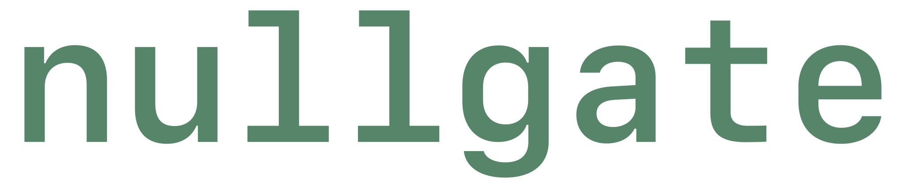

<div align="center">



# Nullgate Python SDK 2

**Prepare protection requests. Your HTTP client sends them.**

[](https://www.python.org/)
[](#-what-it-does)
[](https://nullgate.club)
[](https://t.me/nullgate_app)

</div>

## 🧭 What it does

The SDK talks to the Nullgate API and gives you ready request data: URLs, bodies,
headers, and form values. It never sends anything to the target site. You send the
prepared requests with your own HTTP client, such as `httpx`.

| Product | What you get | SDK method | Guide |
|---|---|---|---|
| Akamai | Sensor, pixel, and SBSD requests | `page.sensor()`, `page.pixel()`, `page.sbsd()` | [Akamai](https://nullgate.club/en/akamai) |
| Amazon FWCIM | The `metadata1` form value | `page.fwcim()` | [Amazon](https://nullgate.club/en/amazon) |
| Amazon ACIC | PoW and AWS WAF answers | `ng.acic_pow()`, `ng.acic_waf()` | [ACIC](https://nullgate.club/en/amazon-acic) |
| ThreatMetrix | A full profiling session | `page.threatmetrix()` | [ThreatMetrix](https://nullgate.club/en/threatmetrix) |
| Classifier | Image labels and text-query matches | `ng.classify()`, `ng.match()` | [Classifier](https://nullgate.club/en/classifier) |

Shared topics: [sessions](https://nullgate.club/en/sessions),
[errors](https://nullgate.club/en/errors), and [billing](https://nullgate.club/en/billing).

## 🚀 Quick start

1. Get an API key in the Telegram bot [@nullgate_app](https://t.me/nullgate_app).
2. Install the SDK from Git and set your key and target page:

   ```sh
   pip install git+https://github.com/nullgate-club/nullgate-sdk-py
   export NULLGATE_API_KEY=ng_your_key
   export TARGET_URL=https://your-target.example/login
   ```

3. Prepare and send an Akamai sensor:

   ```python
   import os
   import httpx
   from nullgate import Nullgate

   UA = "Mozilla/5.0 (Windows NT 10.0; Win64; x64) AppleWebKit/537.36 (KHTML, like Gecko) Chrome/146.0.0.0 Safari/537.36"
   url = os.environ["TARGET_URL"]
   with Nullgate() as ng, httpx.Client(headers={"User-Agent": UA}) as http:
       session = ng.session(user_agent=UA)
       html = http.get(url).text
       page = session.page(url, html)
       assert page.sensor_url is not None
       sensor = page.sensor(script=http.get(page.sensor_url).text, cookies=http.cookies)
       sensor.wait()
       http.post(sensor.url, content=sensor.body, headers=sensor.headers)
   ```

## 📦 Products

### Amazon FWCIM

`page.fwcim(form="#signin", timing=performance_timing, inputs={"ap_email": email})`
returns `metadata1`.

### Amazon ACIC

Pass the current ACIC action type and challenge HTML. Wait before you submit the
response to Amazon. Assign the response verbatim, without JSON-encoding it again.

```python
with Nullgate() as ng:
    proof = ng.acic_pow(acic_result["actionType"], acic_html)
    proof.wait()
    acic_body["context"] = acic_result["clientSideContext"]
    acic_body["response"] = proof.response
```

- `started_at_ms` is optional: the challenge start time in Unix milliseconds. The
  server accepts times from 10 minutes before to 1 minute after its current time.
  Without it, the server uses its current time.
- `proof.send_at` is the earliest submission time in Unix seconds.
- In the async client, use `await proof.wait()`.

For AWS WAF, record `presented_at = time.monotonic()` when the problem arrives.
Pass the original problem unchanged and send the verification body with your own client.

```python
import time

with Nullgate() as ng:
    selection = ng.acic_waf(problem)
    waf_body = selection.verification_body(
        problem, elapsed_seconds=time.monotonic() - presented_at, locale="en-US"
    )
```

- Each successful generation charges one `amazon.acic` operation.
- Unsupported challenges raise `NullgateError` with code `unsupported`.
- The SDK does not submit answers to Amazon or AWS.
- ACIC JSON bodies use the normal gzip path.

For local discovery and target request preparation, use `from nullgate import acic`:
`acic.discover(url, html)`, `acic.parse_result(headers)` and
`acic.discover_waf(url, html)`. The returned setup builds `start()`, `answer(...)`
and `continuation(...)` requests for your existing HTTP client.
See [the complete PoW/WAF flow](examples/acic.py) and
[the ACIC guide](https://nullgate.club/en/amazon-acic).

### ThreatMetrix

Open a profile with `async with page.threatmetrix(send=my_send) as tmx:`, then call
`await tmx.pagehide()`.

For wrapper scripts, pass `collector={"url": url, "org_id": org, "session_id": visit}`
instead of `script_url`. See [`examples/kleinanzeigen.py`](examples/kleinanzeigen.py).

### Classifier

`ng.classify(images, labels=[...])` takes raw JPEG/PNG/WebP bytes, one image or up to
32, and returns one result per image.

```python
from pathlib import Path

with Nullgate() as ng:
    classified = ng.classify(Path("photo.jpg").read_bytes(), labels=["cat", "dog"], model="fast")
    print(classified.results[0].label, classified.results[0].scores)
```

`scores` follow the order of `labels`. `model` is `fast`, `balanced` (default) or `precise`.

`ng.match()` scores images against text queries:

```python
with Nullgate() as ng:
    matched = ng.match(Path("photo.jpg").read_bytes(), queries=["a cat", "a dog"])
    print(matched.results[0].scores)
```

Match scores are independent probabilities in query order, not a distribution that
sums to one.

## 🛠️ Advanced

**Async client.** Use `from nullgate.aio import Nullgate` for async network methods
and `await result.wait()`.

**API transport.** Pass `transport=` to inject an HTTPX API transport (sync or async).
It never handles target requests or ThreatMetrix sockets.

**Compression.**

- The SDK uses gzip for bodies of at least 1024 bytes from the first request.
- Transports see compressed bytes.
- HTTP 415 disables compression.
- `classify` and `match` send images as raw `multipart/form-data` parts and never use gzip.

**Sensor scripts.** Keep passing `script` to `page.sensor`. The SDK uploads it only
until the server retains it, and retries once if needed.

**Prepared inputs.** Use `from nullgate import prepare_inputs, PreparedInput`. Pass
prepared `inputs` to sensor or FWCIM, including password summaries without raw values.

**Inputs and actions.**

- Omitted `inputs`/`actions` preserve collection defaults. `[]` sends an explicitly
  empty collection.
- Action `value` fields cannot contain strings, regardless of event type. Sensor calls
  reject them with `invalid_actions`.

**When to stop sending sensors.** Use `from nullgate.akamai import is_enough, abck_counters`
to stop ordinary sensor sends. This does not prove target acceptance.

**Reporting.** Call `result.report()` after a target failure. `True` means HTTP
delivery only.

## ⚠️ Errors

Catch `NullgateError` and inspect `code`, `message`, `request_id`, and `status`.
Maintenance retries are automatic. See the [error reference](https://nullgate.club/en/errors).

## 📚 Examples

Runnable scripts:

- [`examples/akamai.py`](examples/akamai.py)
- [`examples/amazon.py`](examples/amazon.py)
- [`examples/acic.py`](examples/acic.py)
- [`examples/threatmetrix.py`](examples/threatmetrix.py)
- [`examples/kleinanzeigen.py`](examples/kleinanzeigen.py)

[Documentation and callback recipes](https://nullgate.club)

## 🧑‍💻 Development

Run development checks:

```sh
make check
```
